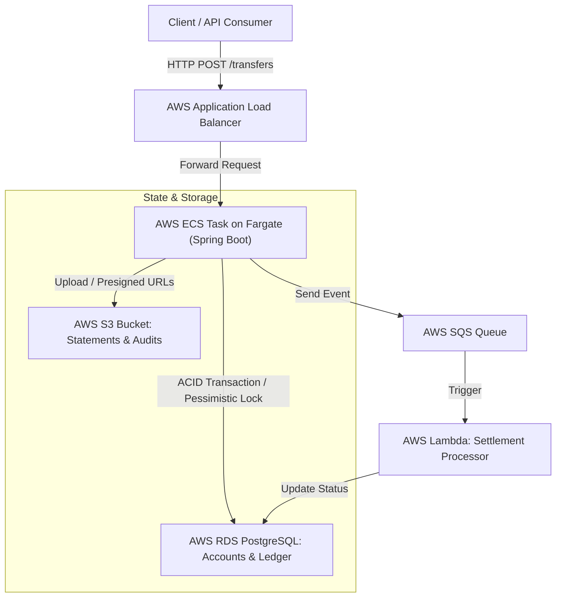
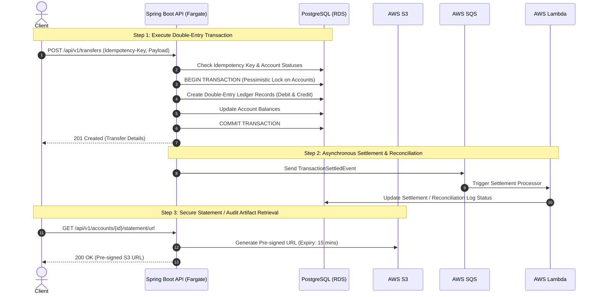

# LedgerStream (Ledger/Accounts, FinTech) Pet Project
This pet project is to demonstrate the skills of AI-assisted technical design and implementation using:
- Java, Spring Boot
- PostgreSQL
- AWS - ECS/Fargate, ALB, RDS, S3, Lambda, SQS, serverless architecture
- Terraform
- Git/GitHub

# Technical Design Document: LedgerStream (Ledger/Accounts, FinTech)

## 1. System Overview & Architecture

LedgerStream is a core financial ledger and transaction processing service designed for high reliability, strict ACID compliance, and secure cloud-native deployment on **AWS ECS with Fargate**, backed by **Amazon RDS PostgreSQL**, **AWS S3**, and **AWS SQS/Lambda**.



## 2. Core Transaction Flow
The sequence diagram below illustrates how client requests are processed through double-entry database constraints with pessimistic locking, and emitted asynchronously for settlement.



## 3. Database Schema & Mock Data (Liquibase Changelog)

### 3.1 Master Changelog (db.changelog-master.yaml)

```yaml
databaseChangeLog:
  - include:
      file: db/changelog/changes/001-initial-schema.sql
  - include:
      file: db/changelog/changes/002-sample-mock-data.sql
```

### 3.2 Initial Schema (001-initial-schema.sql)

```sql
-- Liquibase formatted sql
-- changeset ledgerstream:001-initial-schema

CREATE TABLE accounts (
    id VARCHAR(36) PRIMARY KEY,
    account_number VARCHAR(34) NOT NULL UNIQUE,
    holder_name VARCHAR(100) NOT NULL,
    currency VARCHAR(3) NOT NULL DEFAULT 'NZD',
    balance NUMERIC(19, 4) NOT NULL DEFAULT 0.0000,
    status VARCHAR(20) NOT NULL DEFAULT 'ACTIVE',
    created_at TIMESTAMP WITH TIME ZONE DEFAULT CURRENT_TIMESTAMP,
    updated_at TIMESTAMP WITH TIME ZONE DEFAULT CURRENT_TIMESTAMP
);

CREATE TABLE ledger_entries (
    id VARCHAR(36) PRIMARY KEY,
    transaction_reference VARCHAR(50) NOT NULL,
    account_id VARCHAR(36) NOT NULL REFERENCES accounts(id),
    entry_type VARCHAR(6) NOT NULL CHECK (entry_type IN ('DEBIT', 'CREDIT')),
    amount NUMERIC(19, 4) NOT NULL,
    currency VARCHAR(3) NOT NULL DEFAULT 'NZD',
    description VARCHAR(255),
    created_at TIMESTAMP WITH TIME ZONE DEFAULT CURRENT_TIMESTAMP
);

CREATE TABLE idempotency_keys (
    idempotency_key VARCHAR(100) PRIMARY KEY,
    request_hash VARCHAR(64) NOT NULL,
    response_body TEXT,
    created_at TIMESTAMP WITH TIME ZONE DEFAULT CURRENT_TIMESTAMP
);

CREATE INDEX idx_ledger_tx_ref ON ledger_entries(transaction_reference);
CREATE INDEX idx_ledger_account_id ON ledger_entries(account_id);
```

### 3.3 Sample Mock Data (002-sample-mock-data.sql)

```sql
-- Liquibase formatted sql
-- changeset ledgerstream:002-sample-mock-data

INSERT INTO accounts (id, account_number, holder_name, currency, balance, status) VALUES
('acc-001-nzd', 'NZ01-8839-0012938-00', 'Kelvin Smith', 'NZD', 15000.0000, 'ACTIVE'),
('acc-002-nzd', 'NZ01-8839-0098412-00', 'Treasury Ops', 'NZD', 500000.0000, 'ACTIVE'),
('acc-003-nzd', 'NZ01-8839-0044123-00', 'Jane Doe', 'NZD', 250.5000, 'ACTIVE');

INSERT INTO ledger_entries (id, transaction_reference, account_id, entry_type, amount, currency, description) VALUES
('tx-init-001', 'TX-INIT-20261018-01', 'acc-002-nzd', 'DEBIT', 15000.0000, 'NZD', 'Initial funding for Kelvin Smith'),
('tx-init-002', 'TX-INIT-20261018-01', 'acc-001-nzd', 'CREDIT', 15000.0000, 'NZD', 'Initial account balance creation');
```

## 4. Application Implementation Details

### 4.1 Core Transfer Service (TransferService.java)

```java
package fintech.ledger.service;

import fintech.ledger.domain.LedgerEntry;
import fintech.ledger.repository.AccountRepository;
import fintech.ledger.repository.LedgerRepository;
import org.springframework.stereotype.Service;
import org.springframework.transaction.annotation.Transactional;

import java.math.BigDecimal;
import java.util.List;
import java.util.UUID;

@Service
public class TransferService {

    private final AccountRepository accountRepository;
    private final LedgerRepository ledgerRepository;

    public TransferService(AccountRepository accountRepository, LedgerRepository ledgerRepository) {
        this.accountRepository = accountRepository;
        this.ledgerRepository = ledgerRepository;
    }

    @Transactional
    public String executeTransfer(String sourceAccountId, String destinationAccountId, BigDecimal amount, String currency, String description) {
        if (amount.compareTo(BigDecimal.ZERO) <= 0) {
            throw new IllegalArgumentException("Transfer amount must be strictly positive");
        }

        var sourceAccount = accountRepository.findByIdForUpdate(sourceAccountId)
            .orElseThrow(() -> new IllegalArgumentException("Source account not found"));
        var destAccount = accountRepository.findByIdForUpdate(destinationAccountId)
            .orElseThrow(() -> new IllegalArgumentException("Destination account not found"));

        if (sourceAccount.getBalance().compareTo(amount) < 0) {
            throw new IllegalStateException("Insufficient funds in source account");
        }

        String txRef = "TX-" + UUID.randomUUID().toString().substring(0, 8).toUpperCase();
        var debitEntry = LedgerEntry.createDebit(txRef, sourceAccountId, amount, currency, description);
        var creditEntry = LedgerEntry.createCredit(txRef, destinationAccountId, amount, currency, description);

        ledgerRepository.saveAll(List.of(debitEntry, creditEntry));

        accountRepository.updateBalance(sourceAccountId, sourceAccount.getBalance().subtract(amount));
        accountRepository.updateBalance(destinationAccountId, destAccount.getBalance().add(amount));

        return txRef;
    }
}
```

### 4.2 Mockito Unit Test Suite (TransferServiceTest.java)

```java
package fintech.ledger.service;

import fintech.ledger.domain.Account;
import fintech.ledger.repository.AccountRepository;
import fintech.ledger.repository.LedgerRepository;
import org.junit.jupiter.api.BeforeEach;
import org.junit.jupiter.api.DisplayName;
import org.junit.jupiter.api.Test;
import org.junit.jupiter.api.extension.ExtendWith;
import org.mockito.Mock;
import org.mockito.junit.jupiter.MockitoExtension;

import java.math.BigDecimal;
import java.util.Optional;

import static org.junit.jupiter.api.Assertions.*;
import static org.mockito.ArgumentMatchers.anyList;
import static org.mockito.ArgumentMatchers.eq;
import static org.mockito.Mockito.*;

@ExtendWith(MockitoExtension.class)
class TransferServiceTest {

    @Mock
    private AccountRepository accountRepository;

    @Mock
    private LedgerRepository ledgerRepository;

    private TransferService transferService;

    @BeforeEach
    void setUp() {
        transferService = new TransferService(accountRepository, ledgerRepository);
    }

    @Test
    @DisplayName("Should successfully process double-entry transfer between accounts")
    void executeTransfer_Success() {
        String sourceId = "acc-001";
        String destId = "acc-002";
        BigDecimal amount = new BigDecimal("100.00");

        Account sourceAcc = new Account(sourceId, "NZ01-001", "Alice", "NZD", new BigDecimal("500.00"), "ACTIVE");
        Account destAcc = new Account(destId, "NZ01-002", "Bob", "NZD", new BigDecimal("50.00"), "ACTIVE");

        when(accountRepository.findByIdForUpdate(sourceId)).thenReturn(Optional.of(sourceAcc));
        when(accountRepository.findByIdForUpdate(destId)).thenReturn(Optional.of(destAcc));

        String txRef = transferService.executeTransfer(sourceId, destId, amount, "NZD", "Peer-to-peer payment");

        assertNotNull(txRef);
        assertTrue(txRef.startsWith("TX-"));

        verify(ledgerRepository, times(1)).saveAll(anyList());
        verify(accountRepository).updateBalance(eq(sourceId), eq(new BigDecimal("400.00")));
        verify(accountRepository).updateBalance(eq(destId), eq(new BigDecimal("150.00")));
    }

    @Test
    @DisplayName("Should throw exception when source balance is insufficient")
    void executeTransfer_InsufficientBalance() {
        String sourceId = "acc-001";
        String destId = "acc-002";
        BigDecimal amount = new BigDecimal("1000.00");

        Account sourceAcc = new Account(sourceId, "NZ01-001", "Alice", "NZD", new BigDecimal("100.00"), "ACTIVE");
        Account destAcc = new Account(destId, "NZ01-002", "Bob", "NZD", new BigDecimal("50.00"), "ACTIVE");

        when(accountRepository.findByIdForUpdate(sourceId)).thenReturn(Optional.of(sourceAcc));
        when(accountRepository.findByIdForUpdate(destId)).thenReturn(Optional.of(destAcc));

        assertThrows(IllegalStateException.class, () ->
            transferService.executeTransfer(sourceId, destId, amount, "NZD", "Payment")
        );

        verify(ledgerRepository, never()).saveAll(anyList());
    }
}
```

## 5. Deployment & Operational Runbook

- Build Container: Package the Spring Boot application into a multi-stage Docker image and push to AWS ECR.

- Database Migration: Liquibase automatically runs migrations on startup against RDS PostgreSQL.

- AWS Fargate Deployment: Deploy ECS Task Definition behind an Application Load Balancer (ALB) with secure private VPC subnets.

- Testing: Issue HTTP POST requests to the ALB endpoint with appropriate Idempotency-Key headers.

# Development

## File structure

```text
ledger-aws-java/
├── .github/workflows/          # CI/CD pipeline (GitHub Actions for Gradle build, tests, & Docker push)
├── src/                        # Java Spring Boot Source Code
│   ├── main/
│   │   ├── java/
│   │   │   └── fintech/
│   │   │       └── ledger/
│   │   │           ├── LedgerStreamApplication.java # Spring Boot main entry point
│   │   │           ├── controller/              # REST Controllers (Transfers, Accounts)
│   │   │           ├── service/                 # Business Logic (TransferService, S3 Service)
│   │   │           ├── repository/              # Spring Data JPA / JDBC Repositories
│   │   │           └── domain/                  # Domain Entities & Records (Account, LedgerEntry)
│   │   └── resources/
│   │       ├── application.yml              # App configuration (DB, S3, AWS SDK)
│   │       └── db/
│   │           └── changelog/               # Liquibase Migrations
│   │               ├── db.changelog-master.yaml
│   │               ├── changes/
│   │               │   ├── 001-initial-schema.sql
│   │               │   └── 002-sample-mock-data.sql
│   └── test/                        # Unit & Integration Tests (JUnit 5, Mockito, Testcontainers)
│       └── java/
│           └── fintech/
│               └── ledger/
│                   └── service/
│                       └── TransferServiceTest.java
├── lambda/                     # Asynchronous Settlement Lambda Handler (Go)
│   └── settlement-handler/
│       └── main.go             # Go (Golang) Lambda entrypoint for processing SQS events
├── terraform/                  # Infrastructure as Code (AWS ECS Fargate, RDS, ALB, S3, SQS)
│   ├── variables.tf            # Environment parameters
│   ├── provider.tf             # AWS provider setup
│   ├── vpc.tf                  # Networking & Subnets
│   ├── alb.tf                  # Application Load Balancer
│   ├── ecs.tf                  # ECS Cluster & Fargate Task Definition
│   ├── rds.tf                  # Amazon RDS PostgreSQL instance
│   ├── s3.tf                   # S3 Bucket for audit statements
│   ├── lambda.tf               # Lambda
│   └── sqs.tf                  # SQS Queue
├── Dockerfile                  # Multi-stage Docker build for Spring Boot on Fargate
├── build.gradle                # Gradle build file (Spring Boot, Liquibase, AWS SDK dependencies)
├── settings.gradle             # Gradle settings
├── Makefile                    # Automation for local build, Docker build, and testing
└── README.md                   # Comprehensive architecture & setup guide
```

## Infrastructure as Code

### AWS Commands
```bash
aws login
aws sts get-caller-identity
aws configure

aws lambda list-functions --region ap-southeast-2
aws lambda get-function --function-name ledger-stream-settlement-dev --region ap-southeast-2

aws logs tail /aws/lambda/ledger-stream-settlement-dev --follow --region ap-southeast-2
```

### Terraform Commands
```bash
cd terraform

# NEW AWS EXPERIENCE: Load credentials from cache before running terraform
source ./setup-aws-credentials.sh

# Initialize any providers or modules (good habit)
terraform init

# DEV environment — plan and apply
terraform plan -var-file="terraform-dev.tfvars"
# Apply changes interactively (you'll be prompted with a summary, type 'yes' to confirm)
terraform apply -var-file="terraform-dev.tfvars"
# Or, apply without confirmation (useful for CI/CD)
# terraform apply -var-file="terraform-dev.tfvars" -auto-approve

# PROD environment — plan and apply
terraform plan -var-file="terraform-prod.tfvars"
terraform apply -var-file="terraform-prod.tfvars"

# Destroy resources (cleanup)
terraform destroy -var-file="terraform-dev.tfvars"
```

## Java development

## Go (Golang) development

For comprehensive step-by-step guidance on building and packaging Go Lambda functions, **load the Golang Build skill**:
```
.agents/skills/golang-build/SKILL.md
```

### Quick Start: Build & Package Lambda Functions

```bash
# 1. Initialize Go module (first time only)
go mod init ledger-aws-java

# 2. Install dependencies
go get github.com/aws/aws-lambda-go/events
go get github.com/aws/aws-lambda-go/lambda

# 3. Build individual Lambda handler
cd lambda/settlement-handler
GOOS=linux GOARCH=amd64 CGO_ENABLED=0 go build -o bootstrap main.go
zip function.zip bootstrap
cd ../../

# 4. Or build all handlers using Makefile (recommended)
make build
# 5. Complete pipeline: format → vet → test → build
make all
```

### Build Commands

| Command | Purpose |
|---------|---------|
| `make build` | Build all Go (Golang) Lambda functions |
| `make clean` | Remove build artifacts |
| `make all` | Complete pipeline: format → vet → test → build |

### CI/CD: Automated Build via GitHub Actions

The project includes an automated build workflow (`.github/workflows/build-golang.yml`) that runs on every push/PR to:
1. **Format & Lint** Go code
2. **Run Unit Tests** with coverage reporting
3. **Build** all Lambda function binaries for Linux/AMD64
4. **Package** binaries as ZIP files for Lambda deployment
5. **Security Scan** dependencies for vulnerabilities

The workflow triggers automatically on changes to:
- `lambda/**` — Lambda handler code
- `go.mod`, `go.sum` — Dependencies
- `Makefile` — Build automation
- `.github/workflows/build-golang.yml` — Workflow definition itself

# Testing

## Test API with curl
```bash

```
